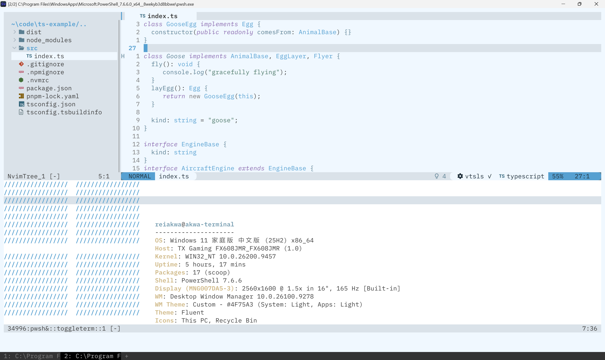

# alice.nvim

Alice 系列的 Neovim 配色：一套浅色 + 两套深色，共用同一份高亮规格与同一套色板 token。



| 主题 | 底色 | 基调 |
|---|---|---|
| **alice-sunny** | `#f0f8ff`（AliceBlue） | 浅色 · 明亮 · 柔和 |
| **alice-rainy** | `#1f252a` | 深色 · 冷灰蓝 · 低饱和 |
| **alice-nightly** | `#090e12` | 深色 · 近纯黑 · 高对比 |

这是 [magic-doll-vibe](https://github.com/reiAkwa/magic-doll-vibe) 家族的 Neovim 实现：与 Helix / WezTerm / Zed / VS Code 等端口共用同一套调色板与视觉语言（`acc1 = #56a0d1`、`acc2 = #5b7f92` 跨平台一致）。

## 特性

- **零依赖**：纯 Lua，原生 `colors/*.lua` 加载，不需要任何构建步骤或第三方库
- **一份规格驱动三套主题**：`groups.lua` 里 411 条规则 + 13 条 `hi link` + 100 条 treesitter 链接，改一条规则三套主题同时生效
- **真彩色 + 256 色兜底**：每个色板条目自带 `cterm` 值，未写时按最接近的 xterm-256 自动换算
- **插件覆盖**：telescope、blink.cmp、nvim-cmp、neo-tree、trouble、notify、mason、lazy、dropbar、flash、hop、leap、navic、dashboard、alpha、rainbow-delimiters、indent-blankline、mini.*（statusline / tabline / diff / indentscope / jump / clue）等
- **显式设置全部属性**：不依赖 Neovim 默认高亮残留，换 nvim 版本不会突然变色

## 要求

- Neovim >= 0.10（需要 `colors/*.lua` 支持；在 0.12.5 上验证）

## 安装

`vim.pack`（Neovim 0.12+ 原生）：

```lua
vim.pack.add({ { src = 'https://github.com/reiAkwa/alice.nvim' } })
vim.cmd.colorscheme('alice-sunny')
```

lazy.nvim：

```lua
{
  'reiAkwa/alice.nvim',
  lazy = false,
  priority = 1000,
  config = function()
    vim.cmd.colorscheme('alice-sunny')
  end,
}
```

手动：把仓库放进 `~/.local/share/nvim/site/pack/*/start/alice.nvim`（或任何 `runtimepath` 目录）。

## 使用

```vim
:colorscheme alice-sunny
:colorscheme alice-rainy
:colorscheme alice-nightly
```

等价的 Lua 写法，方便做主题切换器或按时间自动切换：

```lua
require('alice').load('nightly')       -- 变量名可省略 alice- 前缀
require('alice').load('alice-rainy')   -- 带前缀也接受
```

想覆盖单个高亮组（比如透明背景、加大注释对比度）：

```lua
vim.api.nvim_create_autocmd('ColorScheme', {
  pattern = { 'alice-sunny', 'alice-rainy', 'alice-nightly' },
  callback = function()
    vim.api.nvim_set_hl(0, 'Normal', { bg = 'NONE' })
    vim.api.nvim_set_hl(0, 'Comment', { fg = '#8f9396', italic = true })
  end,
})
```

终端 16 色会随主题写入 `g:terminal_color_0..15`，`:terminal` 直接可用。

## 结构

```
alice.nvim/
├── colors/
│   ├── alice-sunny.lua        # require('alice').load('sunny')
│   ├── alice-rainy.lua
│   └── alice-nightly.lua
├── lua/alice/
│   ├── palette.lua            # 三张语义色板 + ANSI 16 色
│   ├── groups.lua             # 唯一的组定义（411 + 13 + 100）
│   └── init.lua               # 加载器
└── doc/alice.txt
```

- `palette.lua`：每个角色写作 `{ '#RRGGBB', cterm256 }`；`cterm` 可省略，也可以写成另一个角色名做别名（如 sunny 的 `search_fg = 'on_accent'`）。
- `groups.lua`：每条 `{ 组名, 前景角色, 背景角色, 属性可选 }`，按 `editor UI / syntax / rainbow / diagnostics / plugin: *` 分段。
- `init.lua`：`hi clear` → 设 `background` → 按规格 `nvim_set_hl` → 链接 → treesitter 链接（`ColorScheme` autocmd + `defer_fn(0)`，因为 nvim 会在 `:colorscheme` 之后重置 `@` 组）→ `g:terminal_color_*`。

新增一套配色只要在 `palette.lua` 里加一张色板，再在 `colors/` 放一行入口。

## 角色 ↔ 家族 token

`palette.lua` 中的角色名与 [magic-doll-vibe](https://github.com/reiAkwa/magic-doll-vibe) 的 token 一一对应，方便和其它平台对表：

| 角色 | token | 角色 | token |
|---|---|---|---|
| `bg` | `bg1` | `accent` | `acc1` |
| `panel` | `bg2` | `steel` | `acc2` |
| `fg` | `txt1` | `purple` | `acc3` |
| `on_accent` | `txt2` | `green` / `orange` | `str` / `num` |
| `muted` / `warn` / `red` | `comm` / `warn` / `err` | `faint` | `gray` |
| `pale_yellow` / `magenta` / `cyan` | `yellow` / `magenta` / `cyan` | `pink_bg` | `red` |

`search_fg`、`search_bg`、`diff_*_bg`、`matchparen_bg` 是家族色相压深/提亮派生出的 Neovim 专用色，家族 token 里没有对应项。

## 许可

MIT
